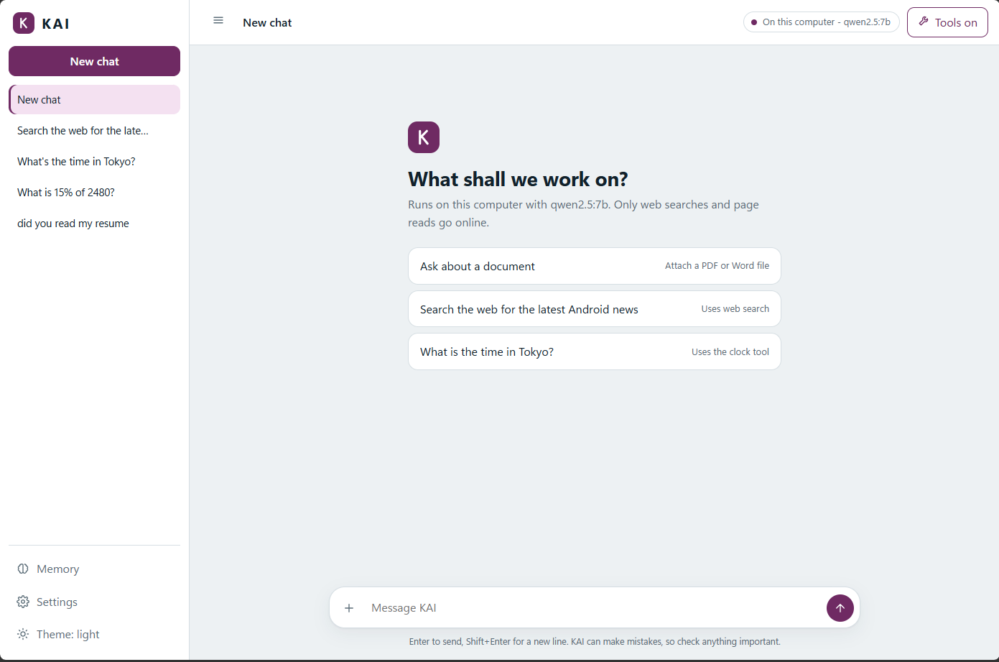
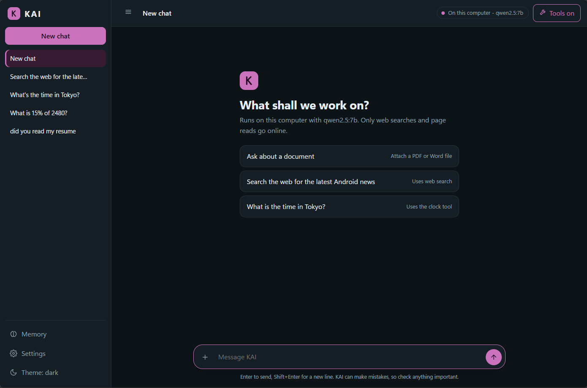

# KAI - Personal AI Assistant

KAI is a personal AI assistant that runs on **your own computer**. Use it in the terminal or in a browser.
It works with a local model through **Ollama** (no API key, chat stays on your machine), or with **Gemini** or **Mistral** in the cloud.
It can search the web, read your documents, use tools, and remember facts you give it.

| Light | Dark |
|---|---|
|  |  |

## Features

**Assistant**
- Streaming replies, in the terminal or in the browser
- Three providers: Ollama (local, for example `qwen2.5:7b`), Gemini, Mistral
- Tools the model can call: time and date, calculator, read/write files (inside `workspace/` only), web search, read a web page, remember and recall facts
- Web search with no API key (DuckDuckGo through the `ddgs` package)
- Long-term memory in `memory.json`. KAI is told to claim only what is saved there, not to invent shared history
- KAI is told not to claim abilities it does not have (reminders, calls, email)

**Website** (`python web_server.py`)
- Chat page with live replies, bold text, lists, code blocks and clickable links
- Several saved chats: new, open, delete
- Attach a **PDF, Word or text file** and ask questions about it. KAI reads only the passages that match the question, so a small model is not overloaded
- Settings: change name, role, tone and instructions, and switch between installed Ollama models
- Memory panel, Tools on/off, Copy and "Try again" on replies
- Light, dark or automatic theme, and four colours
- "Used 2 tools" steps you can expand to see what KAI did
- Works on a phone-sized screen

**Voice** (optional): speak to KAI and hear replies with `/voice on` in the terminal.

## Safety choices

Giving a model tools is risky, so KAI has guard rails:

- Web pages, search results and attached documents are treated as **untrusted**. After reading them, KAI must ask you (Allow/Deny) before it saves a file or stores a memory. This blocks "prompt injection" from a malicious page or file.
- `web_fetch` only opens **public** addresses (no `localhost` or home-network addresses) and re-checks every redirect.
- File tools can only touch the `workspace/` folder.
- The calculator refuses huge expressions such as `9**9**9**9`.
- The website listens only on `127.0.0.1`, rejects requests from other websites, checks every chat id, and limits upload size.
- Network errors and rate limits show a clear message instead of a crash.
- The page never inserts model text as HTML, so a reply cannot run code in your browser.

## Setup (Windows)

```powershell
cd KAI
python -m venv .venv
.venv\Scripts\activate
python -m pip install -r requirements.txt
copy env.example .env
```

Edit `.env` and pick **one** provider:

```
# Ollama, fully local (install Ollama, then run: ollama pull qwen2.5:7b)
MODEL_PROVIDER=ollama
MODEL_NAME=qwen2.5:7b

# or Gemini (free key from Google AI Studio)
MODEL_PROVIDER=gemini
MODEL_NAME=gemini-3.6-flash
GEMINI_API_KEY=your-key-here

# or Mistral
MODEL_PROVIDER=mistral
MISTRAL_API_KEY=your-key-here
```

Keep `.env` private. It is already in `.gitignore`. Never upload API keys or share screenshots that show them.

Tips for local models:
- A 7B model such as `qwen2.5:7b` works well. 3B models call tools when they should not.
- `OLLAMA_NUM_CTX` (default 8192) sets how much text the local model can see at once.

## Run

Browser (opens at http://127.0.0.1:8000):

```powershell
python web_server.py
python web_server.py --port 9000
```

Terminal:

```powershell
python main.py
python main.py --clear      # fresh chat history
python main.py --no-tools
python main.py --voice
```

In the terminal, type `/help` for commands such as `/clear`, `/memory list`, `/persona` and `/tools`.

The terminal keeps its chat in `chat_history.jsonl`. The website keeps its chats in a `chats/` folder. The first time you open the website, your old terminal history is copied in as a chat.

## Files

How the pieces fit together is explained in [ARCHITECTURE.md](ARCHITECTURE.md).

| File | What it does |
|---|---|
| `main.py` | Terminal app |
| `web_server.py`, `index.html` | Website (small local server and the chat page) |
| `assistant.py` | The core: providers, streaming, history, tool loop, safety checks |
| `tools.py` | Tools the model can call |
| `documents.py` | Reads PDF/Word/text files and finds the passages that match a question |
| `chat_store.py` | Saved chats for the website |
| `memory.py` | Long-term memory |
| `config.py` | Settings from `.env` |
| `voice.py` | Optional speech input and output |
| `test_*.py` | Automated tests |

Created while running: `chat_history.jsonl`, `chats/`, `memory.json`, `persona.json`, `workspace/`.

## Run the tests

```powershell
python -m unittest test_config test_documents test_web_server test_links test_web_search test_memory test_ollama test_security test_web_fetch test_prompt test_tools test_errors test_history
```

## Known limits

- Web search uses DuckDuckGo through a scraping package, so it can be rate-limited if you search too fast.
- The website has no login and handles one chat at a time. It is made for your own computer. Do not put it on the internet as it is.
- Scanned PDFs (pictures of text) cannot be read.
- Small local models make mistakes and can invent details. Check important answers, especially anything about people or facts.

## Built with

Python (standard library web server, `requests`, `ddgs`, `pypdf`), plain HTML/CSS/JavaScript, and the Ollama, Gemini and Mistral APIs.
